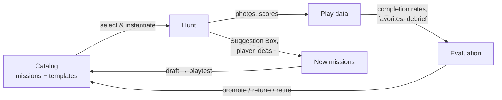

# Photoboom Mission Program: Creation, Curation & Evaluation Plan

*2026-07-15. Builds on [missions_proposal.md](missions_proposal.md) (tag system, theme
packs, templates) and [missions_master.csv](missions_master.csv) (310-mission catalog).
Grounded in the current schema: game-scoped `missions`, photos with
`reviewed`/`rejected`/`bonus_points`, and the new game tiers — the catalog is also a
product asset for paying organizers, not just a personal toolkit.*

## 0. The flywheel



Every hunt both *consumes* the catalog and *feeds* it. The plan below makes each edge
of that loop concrete: §1 creation, §2 curation and growth, §3 evaluation, §4 the
operating cadence that keeps the wheel turning, §5 tooling/schema phases.

---

## 1. Hunt creation: the web builder

**Design principle: the organizer never edits a file.** Hunt creation is a web flow
inside photoboom — the app pre-seeds a mission list from the catalog, then the
organizer customizes it freely before launching. The catalog is a *starting point and
a safety net*, never a constraint: any pre-seeded mission can be edited, re-pointed,
deleted, or replaced, and organizers can write their own missions from scratch at any
point. This is also the product surface that makes the catalog worth paying for
(§5), and it fits the existing `launched_at` gate: **everything below happens while a
game is unlaunched; launching freezes the list.**

### 1.1 Builder flow

**Step 1 — Describe the hunt** (a form, not a spec file). Fields map to catalog facets:

| Field | Feeds |
|---|---|
| Name, date, duration, start/end location | Game record (mostly exists today) |
| City | City pack + city-template slots |
| Audience: families / mixed adults / adults only | Spice ceiling |
| Themes (multi-select chips: geeky, sporty, science, arty, foodie, musical…) | Pack draw |
| Mission count target (default 50) | Draw size |
| Guest of honor (optional name) | Honoree-template slots |
| Expected teams | People-mix rules; `other-team` missions need ≥4 teams |
| "Played with this crowd before?" → pick past games | Overlap filter |
| Toggles: allow `daring`, allow `mischief`, remote/`home-ok` only | Hard filters |

**Step 2 — Review the pre-seeded list.** The app applies §1.2 and presents the draft
list with, per mission: name, description, points, tags, *why it was picked* ("Berkeley
pack", "geeky draw", "playtest candidate"), and its historical completion rate when
known (§3). The organizer works in a two-pane screen — draft list on the left, catalog
browser on the right — with these actions:

- **Edit** any field inline (name/description/points). Edits fork a game-local copy;
  the catalog row is untouched. Materially-changed wording is offered back to the
  catalog as a `proposed` variant at debrief (§2.3) — this is a major mission source.
- **Swap**: "give me a different one like this" — redraws one slot from the same
  tag profile.
- **Delete** / **reorder** (drag; codenum recalculated, fixtures pinned).
- **Add from catalog**: browse/filter/search the full catalog, click to add.
- **Write your own**: a blank mission form. Prompted (optionally) for tags, which makes
  it a `proposed` catalog candidate at debrief.
- **Fill a template**: templates with open slots (landmark pose, tiny landmark, local
  business, honoree missions) render as a mini-form — "Landmark pose: [Campanile]" →
  generates the mission text. This is how city/honoree packs grow without an engineer.
- **Reroll the whole draw** (keeps pinned/edited missions, redraws the rest).

**Step 3 — Balance panel** (live, beside the list). Not a gate, just honest feedback:
kind mix, points curve, people mix, spice histogram, count vs target, playtest quota —
each with a one-line diagnosis ("light on `interact` missions — hunts with <5 of these
score lower on favorites"). Organizer may ignore all of it.

**Step 4 — Review checklist** (§1.3) rendered as a screen, then **Launch**, which
freezes the list, records provenance, and generates the printable PDF.

### 1.2 The pre-seed algorithm

What Step 2 hands the organizer. Deterministic, but only ever a *draft*:

1. **Fixtures first** (~4): Test Photo (1 pt), Team Photo (100, last), Suggestion Box,
   1–2 Create Your Own slots.
2. **Site-specific slots** (~8–12): city pack missions + fresh instantiations of city
   templates (landmark pose, tiny landmark, local business, local legend, checkpoint,
   one high-score task).
3. **Honoree slots** (3–5, if applicable): guest-of-honor templates filled in.
4. **Pack draw** (remaining ~35–40): filter catalog by pack tags, `spice <= ceiling`,
   status `active` or `playtest`, minus everything in `avoid_overlap_with` game
   histories. Then balance:
   - **Size to the clock** (grounded in recovered data, [past_game_stats.md](past_game_stats.md)
     Finding 3): default **~17 missions per hour** of hunt (50 missions / 3 hours).
     Past ~25/hour, completion drops sharply — the 2020 hunt offered 34.8/hour and
     teams simply ignored the list (40% median completion, 13 missions never
     attempted). The builder warns above 25/hour rather than blocking.
   - **Kind mix**: ~⅓ `find`, ~⅓ `pose`/`make`/`wear`, ~⅓ `interact`/`perform`.
   - **Points curve**: roughly 40% at 10, 30% at 20, 20% at 30–50, 10% at 70–100.
     Note points steer attention rather than measure difficulty (§3.5): the 10-point
     tier is where teams *choose* what to skip, so put opportunistic finds there and
     price up anything you actually want done.
   - **People mix**: at least 5 `non-player` missions, 2 `other-team` if ≥4 teams,
     ≥1 `animal`/`baby`-class crowd-pleaser.
   - **Playtest quota**: 10–15% of slots go to `playtest`-status missions — this is
     how new material earns its stripes (see §2.3).
5. **Escalation pairs**: where a selected mission has an escalation variant, include at
   most one tier by default; the builder offers the other as a swap.

### 1.3 Review checklist (a builder screen, ~30 min of organizer time)

Rendered as checkboxes before launch. Advisory, not blocking — except the first, which
is worth a confirm dialog:

- **Spice audit**: every description read at the audience's sensitivity level. If any
  mission exceeds the declared ceiling (e.g. a `risque` mission in a families hunt),
  the builder flags it and asks for an explicit override.
- **Safety/legal audit**: each `daring`/`mischief` mission gets a keep/soften/cut
  decision, stored on the game.
- **Geography walk-through**: site-specific missions reachable within the duration;
  checkpoints not clustered in one corner. (Builder can show them on a map once
  missions carry optional coordinates — later phase.)
- **Freshness check**: overlap filter output reviewed for reworded duplicates.
- **Dry-read test**: someone who didn't build the list reads it cold. Anything they
  can't parse gets rewritten. This catches most description bugs and is the single
  highest-value gate — the builder should nudge for it ("share a preview link").

### 1.4 Launch

**Launch** freezes the mission list, and:

- Records provenance per mission — which catalog mission or template (+ slot values)
  it came from, and whether the organizer edited it. This is what makes §3 stats
  aggregate across games, and what feeds edited wording back to the catalog.
- Generates the printable PDF (the parsed hunts are the format precedent: numbered,
  two-column, points + description) and the mission list screen.
- Snapshots the catalog versions used, so later catalog edits never rewrite history.

---

## 2. Mission curation & development

### 2.1 Catalog governance

- `missions_master.csv` is the **single source of truth** (until Phase 1 moves it into
  the DB). All edits by PR-style diff, so history is git.
- Add two columns now: `status` and `stats` come later from §3.
  - `status`: `proposed` → `playtest` → `active` → `retired` (plus `variant-of:<name>`
    in notes for lineage).
  - New missions enter as `proposed`; they become `playtest` once they pass the style
    guide; `active` after surviving one hunt with acceptable stats; `retired` keeps the
    row (history matters — retired missions inform templates).

### 2.2 Mission style guide (the quality bar)

A mission is ready for `playtest` when:

1. **Title** is a pun, reference, or tease — never a description. (*"Et Tu, Brute?"*,
   not *"Fake stabbing"*.)
2. **Description is one or two sentences** with an unambiguous completion criterion a
   judge can verify from the photo alone. Bonus conditions stated inline.
3. **Photographable**: the evidence fits in a single photo (or explicitly says
   `multi-photo`/`video`).
4. **Team-size robust**: works for teams of 3–6; says "team member" / "multiple" /
   "all" deliberately.
5. **Safe & legal at face value**: anything spicier gets `mischief`/`daring` tags and
   an organizer note.
6. **Tagged completely**: exactly one spice tag, ≥1 kind tag, people/setting tags as
   applicable.
7. **Points assigned** by comparison to the anchor set: Head in Bucket=30 nerve,
   Lookalike=20 luck+attention, Flight=50 coordination, Haircut=100 commitment.

### 2.3 Where new missions come from (growth engine)

Ranked by historical yield:

| Source | Mechanism | Expected yield |
|---|---|---|
| **Suggestion Box** | It's already a mission ("a legible list of three suggested missions"). After each hunt, transcribe every submission into `proposed` rows with source noted | 5–15 per hunt |
| **Template instantiation** | Each new city/honoree/franchise fills 8–15 slots mechanically | 8–15 per hunt |
| **Debrief lightning round** | 10 minutes at the post-hunt gathering: "what mission do you wish had existed?" | 3–5 per hunt |
| **Photo serendipity** | Review the photo stream for *unplanned* great photos — a recurring accidental subject is a mission waiting to be named | 1–3 per hunt |
| **Escalation/variant mining** | For each top-quartile mission (§3), draft one harder tier and one home-ok adaptation | steady trickle |
| **Found lists** | Other hunts encountered in the wild (this exercise netted 651 raw missions — repeat when new material surfaces) | episodic windfalls |

Growth target: **+15 net new `active` missions and +1 template per hunt cycle**; the
catalog should pass 400 active missions within ~6 hunts.

### 2.4 Template development

A template is *earned*, not invented: when 3+ missions share a structure, extract the
pattern into the proposal doc's template list with named slots and 2+ instantiation
examples. Conversely, every template should regenerate at least one fresh mission per
hunt or be marked dormant. Current inventory is 25 templates (proposal §5); track
which template produced each instantiated mission so template quality is measurable
too (a template whose children keep flopping gets reworked).

**New-city recipe** (proven by the net-new Berkeley pack): 1 iconic-landmark pose +
1 tiny-landmark build + 1 miniature bring-back + 2 local businesses with themed
actions + 1 local legend + 1 checkpoint challenge + 1 absurd high-score task +
2–4 local-culture one-offs = a 10–12 mission city pack in an afternoon, refined by
someone who knows the city.

**Franchise/seasonal packs**: keep 2–3 skinnable packs warm (Star Wars precedent from
Flags Day 2015; obvious candidates: Pokémon, Halloween-spooky, winter-holiday — the
seasonal tags already exist).

---

## 3. Evaluation: completion rates, ratings, favorites

### 3.1 What's actually recoverable (the database is gone)

Most historical game data has been lost — the `photos` rows that would have carried
`reviewed`/`rejected`/`bonus_points` no longer exist. What survives is **exported photo
files in `~/Downloads/past_game_photos/`**, whose filenames encode everything we need
for the primary metric:

```
bernsteinbears_71_fort_20200703213835_612.jpeg
└── team ──────┘ │  └mission┘ └timestamp──┘ └id┘
                codenum
```

That yields, per game: teams, missions attempted, per-team per-mission submission,
and submission time. See [past_game_stats.md](past_game_stats.md) for the full
extraction and results across the five recovered games.

**Recoverable from the filenames:**

- **Completion rate** = teams with ≥1 photo for the mission ÷ teams in that game.
- **Time-to-completion** and the ordering teams worked in (`timestamp` − game start).
- **Mission-list join**: four of the five games match mission lists already extracted
  in `actual_missions.csv`, giving true *denominators* — the missions offered but
  never attempted, which are the most informative rows of all.

**Permanently lost, and honestly so:**

- Accept/reject status → **no reject rate**. These exports are presumably accepted
  photos, but that's an assumption, not a fact. The ambiguity signal is gone until new
  games generate it.
- `bonus_points` → no bonus-worthiness.
- Any notion of favorites (never existed).

**Also mineable, separately:** the **Flags Day 2015 xlsx** and **2008 xls** score
matrices in `actual_missions.csv`'s sources record per-team per-mission points —
completion data for ~150 missions predating photoboom, in a different format.

So the historical scorecard has exactly one hard metric — completion rate — for
~230 mission-runs. That is enough to calibrate points (§3.5) and to spot never-completed
missions, and not enough for the full matrix in §3.4. **Everything richer starts
accruing with the next hunt** — which is the real argument for building §3.2's signals
before the next game rather than after.

### 3.2 New signals (small features, big information)

Given §3.1, these are how the catalog starts learning again. Priority order:

1. **Don't lose data again.** Before anything else: back up the photos table and
   blobs, and keep the filename-style export as a *deliberate* artifact rather than an
   accident. The current recovery works only because someone happened to export with
   informative filenames. (Also a paid-tier feature: "download your game archive".)
2. **Player favorites**: a ⭐ on any photo in the game gallery, any player, during +
   after the game. `favorites(user_id, photo_id)`. Mission favorite count = favorites
   on its photos. Cheap, playful, doubles as a "best-of album" feature for paid tiers.
3. **Post-game ballot** (no code to start — a form link on the finish screen):
   "Pick your 3 favorite missions" + "Pick one we should never run again" + free-text.
   Mission-level, so it catches great missions whose *photos* were unremarkable.
4. **Judge's picks**: organizer tags N award photos at game end (the 2008 hunt's
   "judge's favorite" bonus is precedent). Distinct from player favorites — judges see
   every photo.
5. **Organizer debrief note** per mission (one line, optional): "confusing", "site was
   closed", "instant classic". Context that numbers can't carry.

Note that reject rate (§3.4's ambiguity signal) needs no new feature — it just needs
the photos table to survive, since `reviewed`/`rejected` are already columns.

### 3.3 The mission scorecard

Maintained per catalog mission, aggregated across all runs. Phase 0: a generated CSV
(`data/mission_stats.csv`) from the recovered filenames + score matrices; Phase 1: a
SQL view over live game data, with the historical rows retained as seed data.

```
catalog_key | runs | teams_exposed | completion_% | reject_% | fav_votes
| fav_rate (votes ÷ teams_exposed) | bonus_% | ballot_best | ballot_worst | last_run
```

Historical rows populate `runs`, `teams_exposed`, `completion_%`, `last_run` only;
the rest stay null until new games fill them. **Null ≠ zero** — the scorecard must
render "no data" distinctly, or every recovered mission will look like it flopped.

### 3.4 Interpretation matrix → actions

Completion is read **relative to the mission's points tier** (§3.5), since tiers have
very different baselines. "High"/"Low" below mean *versus tier baseline*, not absolute.

| Completion | Favorites | Diagnosis | Action |
|---|---|---|---|
| Above baseline | High | **Core** | Protect; use as pack anchors; mine for variants |
| Above baseline | Low | **Filler** | Keep a few for scoring rhythm; cut the rest; lower points |
| Below baseline | High | **Epic** | Working as intended *if* points are high; cap 3–5 per hunt |
| Below baseline | Low | **Flop** | Check context first (§3.5c), then rewrite once, else retire |
| — | High reject % | **Ambiguous** | Rewrite the completion criterion; re-playtest |
| Never completed in 2+ runs | — | **Mispriced or misplaced** | Raise points, or move to a pack where it fits |

Until favorites exist (§3.2), only the completion column is populated — which is
exactly why the Flop and Epic rows are currently indistinguishable, and why the ballot
is worth standing up before the next hunt.

### 3.5 Points calibration — *revised by the data*

An earlier draft of this plan asserted that points should *predict* completion, with
target bands per tier. **The recovered data refutes that** (see
[past_game_stats.md](past_game_stats.md), Finding 1): correlation(points, completion)
= **+0.15** across 225 runs, and it runs the *wrong way* — 10-pointers complete at 58%
while 70- and 100-pointers complete at ~100%.

Points are not a difficulty estimate. **Points are steering.** Teams triage toward the
big-ticket missions precisely because they're worth a lot, and organizers already price
the must-dos high. Low-point missions are what teams walk past.

The working rule instead:

**Baselines by tier** (median completion, from 225 recovered runs — update each cycle):

| Points | Baseline completion | Read as |
|---:|---:|---|
| 10 | ~58% | cheap; skippable by design |
| 20 | ~60% | the workhorse tier |
| 30 | ~57% | |
| 50–70 | ~90–100% | headline missions; everyone does them |
| 100+ | ~83% | the finale/commitment tier |

- **Judge a mission against its own tier's baseline**, not an absolute target. A
  10-pointer at 58% is normal; at 0% it's a flop.
- **Never-completed at low points = "not worth the walk."** That's a *pricing*
  signal, not a quality verdict: raise the points or cut the mission. Of the 16
  never-completed missions recovered, 15 were 10-pointers.
- **Use points deliberately as steering**: if you want a mission done, price it up.
  If it's a bonus for teams who stumble on it, price it down and accept ~50%.
- **Difficulty prediction comes from tags, not points** (§3.5b).

### 3.5b Tags are the difficulty model

Finding 2 of the recovered data: tags predict completion far better than points do.
Median completion by tag —

| Harder | | Easier | |
|---|---:|---|---:|
| `interact`, `non-player` | 43% | `pose`, `multi-member`, `all-team` | 86% |
| `home-ok` | 40% | `family`, `geeky`, `silly` | 80% |
| `make`, `perform` | 57% | `find` | 60% |

**Missions requiring a stranger's cooperation complete at roughly half the rate of
missions a team can do alone.** This is the single most useful predictive fact
recovered, and it means the builder's balance panel (§1.1 Step 3) should forecast
difficulty from a mission's tags — and warn on `interact`/`non-player`-heavy draws,
which look easy on paper and aren't.

### 3.5c Context beats quality: the `reflective` lesson

Finding 4: 13 of the 16 never-completed missions were in one game (the 2020 remote
hunt), and they cluster in one genre — introspective prompts ("something you loved as
a child", "something given to you by someone you don't talk to any more"). That genre
*works beautifully* in the 2-person prompt exchange it came from, and died in a
competitive 5-team race.

The catalog must therefore encode **context, not just quality**: add a `reflective`
tag, include it in family and prompt-exchange packs, and exclude it from competitive
draws. Generalize: before retiring a "flop", ask whether it was the mission or the
*pairing*. §3.6's variant testing applies to context as much as to wording.

### 3.6 Variant testing

When rewriting an underperformer, keep both rows (`variant-of` lineage), run the new
wording in the next hunt, and compare scorecards. One active variant per mission at a
time; loser retires. Same mechanism vets softened versions of `mischief` missions.

---

## 4. Operating cadence

**Per hunt (the cycle, ~2 weeks around game day):**

- *T−14*: create the game in the builder → describe → review the pre-seeded list →
  customize (§1.1) → walk the route.
- *T−7*: fill site/honoree template slots; dry-read test; print lists; **launch**.
- *Game day*: organizer notes anomalies in the moment.
- *T+3*: judge photos, post ballot link with the results announcement.
- *T+7 debrief*: refresh the scorecard; transcribe Suggestion Box + ballot; harvest
  organizer-edited and organizer-written missions from the game into `proposed` catalog
  rows (§2.3); catalog triage (promote playtests that performed, retire flops); update
  points per §3.5. **Time-box: one hour.** The loop only works if it's cheap.

**Quarterly:**

- Catalog review: prune dated references (the *Sanyo* problem — pop culture decays),
  refresh seasonal packs ahead of their season, check tag hygiene.
- Template audit: dormant templates reworked or archived (§2.4).
- Metrics: catalog size by status, % of active missions with ≥1 run of data,
  median fav_rate trend across hunts (the north star: *are hunts getting better?*).

---

## 5. Build roadmap

The builder is the product, so the phases are ordered to reach it quickly and to stop
losing data on the way.

**Phase 1 — catalog in the database.** `catalog_missions` + `taggings`;
`missions.catalog_mission_id` + `edited_from_catalog` for provenance; seed from
`missions_master.csv` (this file stays as the versioned source for review, and seeds
the table). Nothing user-facing yet — but the catalog stops being a file the app can't
see.

**Phase 2 — the builder.** Steps 1–4 of §1.1: describe form → pre-seed → two-pane
customize screen → balance panel → checklist → launch. Ship it in that order; even
Step 1 + a plain pre-seeded list beats today's blank-slate mission entry. The template
fill-in form (Step 2) is what lets organizers grow city packs without an engineer.
This is the tier moat: **Free** = standard pack pre-seed, **Party/Team** = full
catalog, city packs, template forms, custom packs.

**Phase 3 — feedback loop.** `favorites` table + ⭐ UI; ballot ingestion; judge's
picks; scorecard view; historical rows seeded from Phase 0 below. Then the builder can
show completion rates beside each pre-seeded mission (§1.1 Step 2) — the loop closes.

**Phase 4 — archive & export.** Deliberate game archive (photos + metadata, the
filename convention that just saved us), backups, "download your game" for paid tiers.
Arguably belongs in Phase 1 given §3.1; sequence it by how soon the next game runs.

**Phase 0 — right now, no code:**
1. ✅ `status` column added to `missions_master.csv` (301 `active` from real hunts,
   9 net-new `playtest`).
2. ✅ Historical completion extracted from `~/Downloads/past_game_photos/` →
   [past_game_stats.md](past_game_stats.md) + [mission_stats.csv](mission_stats.csv).
3. Backfill the 2015/2008 score matrices into the same scorecard (different format,
   same shape — ~150 more mission-runs).
4. Draft the post-game ballot form (a Google Form is fine) so the *next* hunt produces
   favorites data even if Phase 3 hasn't shipped.
5. Back up the current photos table and blobs. Today.
